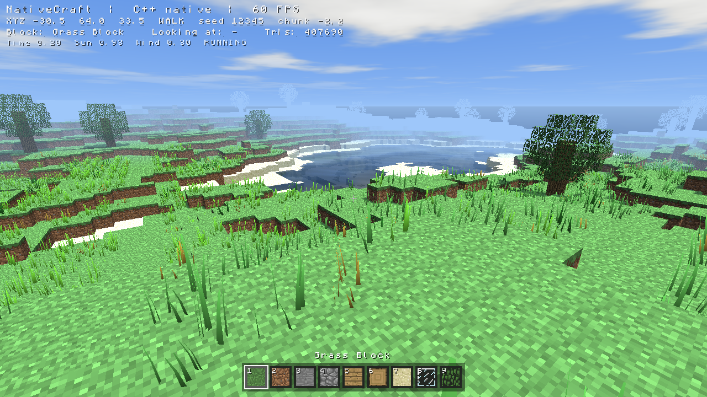
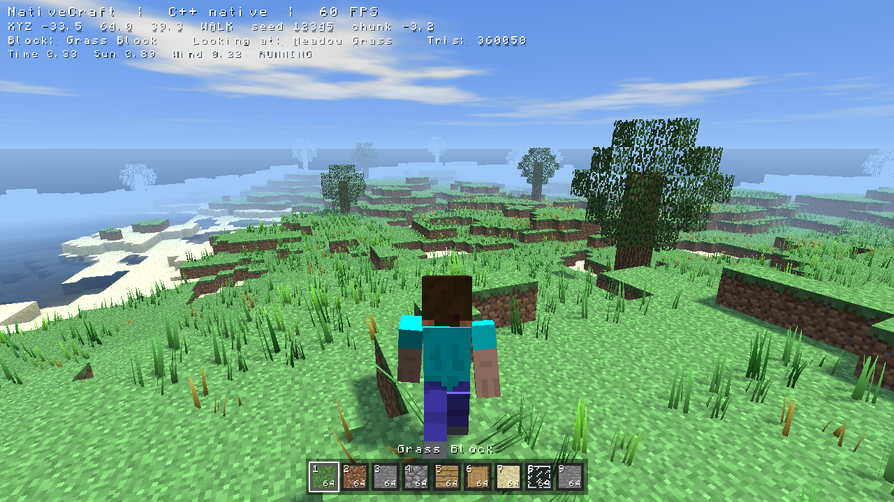
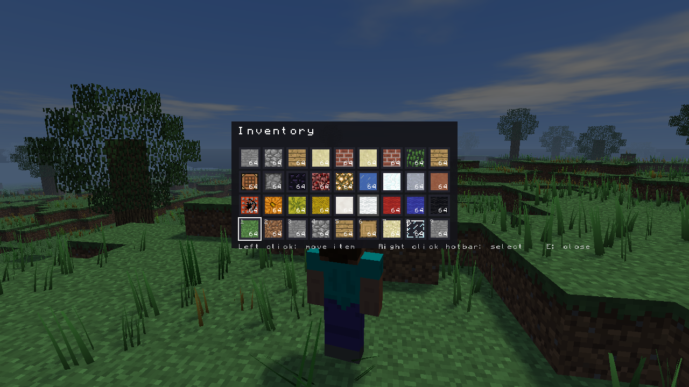
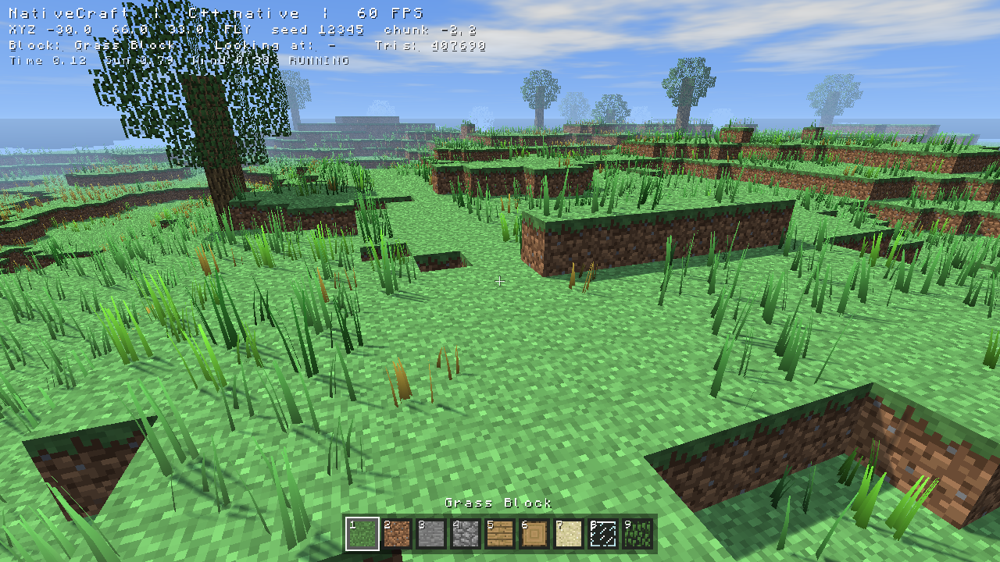
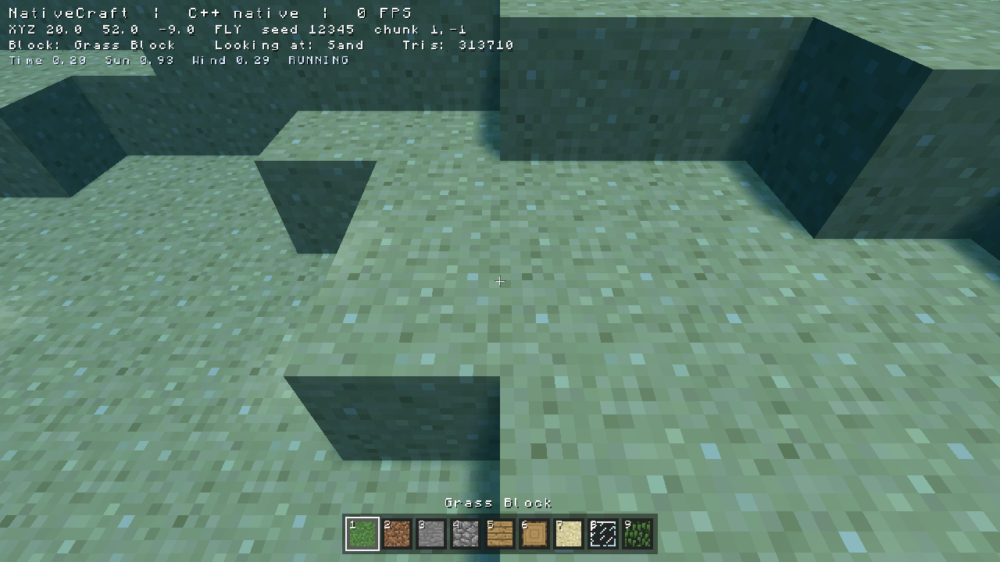
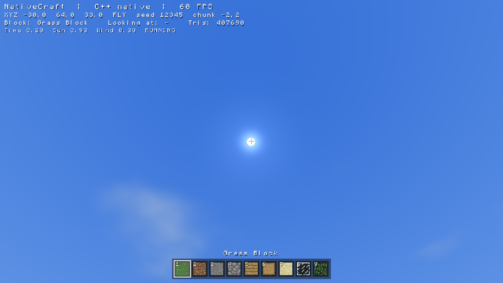
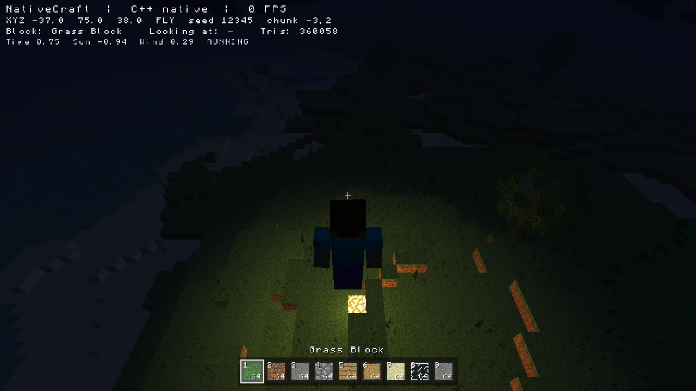
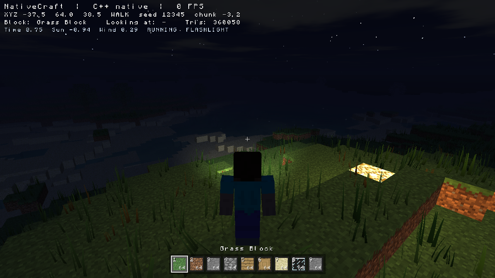
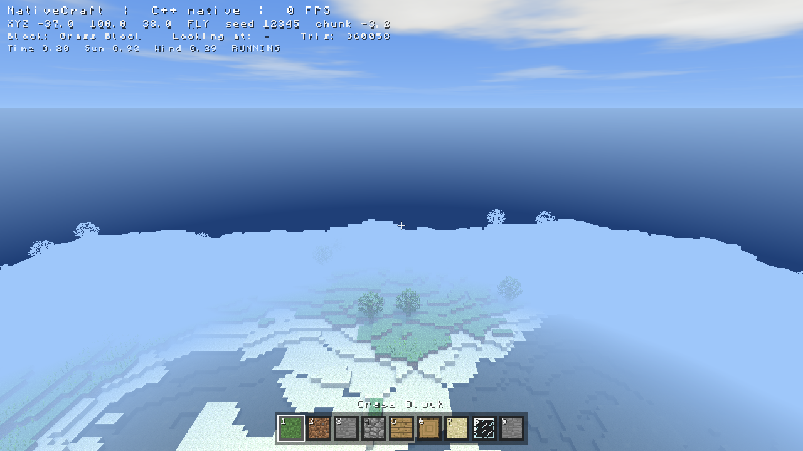
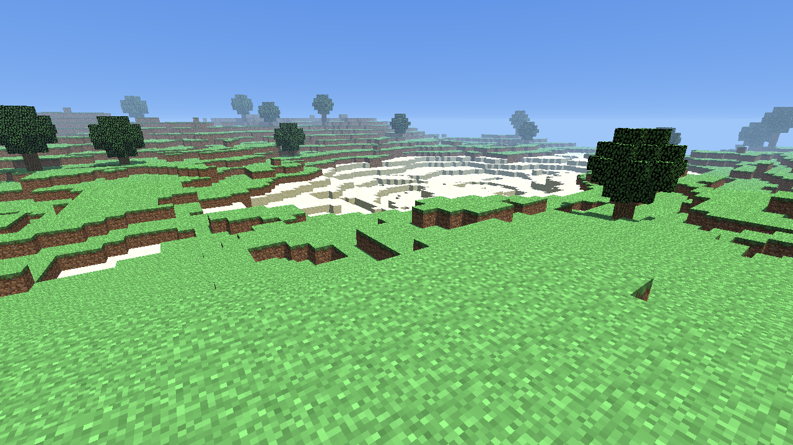

# NativeCraft

A native C++20 Minecraft-style client with an infinite procedural world. It does not use Java or the JVM. Rendering, multithreaded terrain generation, chunk streaming, water simulation, persistence, and audio are implemented from scratch.

Textures, block models, blockstates, the bitmap font, language files, and sounds are read from a local Minecraft 1.12.2 installation. The repository does not contain Minecraft assets.

## Screenshots
























## Requirements

- C++20 compiler (GCC 16 tested)
- CMake 3.20 or newer
- SDL2
- OpenGL 3.3
- libpng
- zlib
- OpenAL
- libvorbis and libvorbisfile

Installation instructions for Arch, Debian/Ubuntu, and Fedora are in [docs/INSTALL.md](docs/INSTALL.md).

## Build

```bash
cmake -S . -B build -DCMAKE_BUILD_TYPE=Release
cmake --build build -j
```

## Run

```bash
./build/nativecraft --mc-dir "$HOME/.minecraft"
```

The directory must contain:

```text
versions/1.12.2/1.12.2.jar
assets/indexes/1.12.json
assets/objects/
```

Worlds are generated from a seed. Modified chunk data is stored under `saves/<seed>/chunks/` and reloaded on demand.

Useful options:

```text
--seed N                world seed
--render-distance N     chunk render radius, default 6
--grass-distance N      radius with grass meshes, default 3
--threads N             chunk generation threads, default: auto
--time T                time of day in [0,1]
--time-speed S          day cycle speed
--third-person          start in third-person view
--flashlight            start with flashlight enabled
--camera X Y Z YAW PITCH
--screenshot PATH
--raytrace PATH         software ray tracing test render, 1280x720
--frames N
```

## Controls

| Input | Action |
|---|---|
| Mouse | Look |
| W/A/S/D | Move |
| Space | Jump, swim up, or fly up |
| Ctrl | Swim down or fly down |
| Shift | Sprint |
| F | Toggle flight |
| E | Open or close inventory |
| F5 | Toggle first/third person view |
| L | Toggle flashlight |
| M | Toggle mouse capture |
| T | Pause or resume the day cycle |
| 1-9, mouse wheel | Select hotbar slot |
| Left click | Break block |
| Right click | Place block |
| F2 | Save screenshot to `screenshots/` |
| Esc | Exit |

## Rendering and world features

- Infinite chunk streaming around the player with deterministic seed-based generation.
- Chunk generation and disk loading run on a worker pool; mesh construction is budgeted to two chunks per frame.
- Chunk unloading and binary persistence for modified chunks.
- Multiple procedural grass types: tall grass, meadow grass, dry grass, and fern with distinct colors, blade counts, and heights.
- Grass reacts to changing wind direction, gust strength, and the player's position.
- Two-cascade directional shadows: 4096 near cascade for detailed grass and terrain shadows plus a 4096 far cascade covering the render distance, both with a 16-tap rotated Poisson PCF kernel for soft shadow edges, and cached updates.
- Separate near/far normal offsets and bias values reduce sunlight leaks in dark areas.
- Breakable grass with a raycast hitbox: aim and left-click to remove it, or right-click to replace it with a block.
- Procedural moving clouds, sun, moon, and stars.
- Planar water reflections, animated waves, ripples, Fresnel reflections, and specular highlights.
- Swimming with buoyancy, underwater fog, blue-green underwater color, caustics, and sun glints through the water surface.
- Deeper procedural water basins for diving, plus huge snow-capped mountains.
- Water simulation: exposed underwater air refills and connected air pockets below sea level flood.
- Bottom slabs for stone, cobblestone, oak, sandstone, and bricks with partial collision and step-up.
- Background music, looping water ambience when swimming, synthetic bird chirps, and low-altitude mist.
- Dynamic point lights from placed glowstone and lava; glowstone/lava surfaces are emissive.
- Handheld flashlight spotlight with warm color, inner/outer cone falloff, range attenuation, and an HUD indicator. Starts with `--flashlight` or toggles with L.
- Third-person Steve player model with skin, walk, idle, jump, swim, and attack animations. The model casts shadows in both shadow cascades.
- Inventory with 27 storage slots and a 9-slot hotbar, item counts, block icons, click-to-move, and hotbar selection.
- Frustum culling for shadow, reflection, opaque, grass, transparent, and water passes.
- Grass LOD: detailed grass meshes are limited to a configurable radius.

## Current scale

- 87 blocks, 101 unique block textures, 103 texture-array layers.
- Player and inventory screens; third-person view is available with `--third-person` or F5.
- Default render radius: 6 chunks (169 meshed chunks, 225+ loaded).
- About 400,000 triangles in the default view.
- About 60 FPS at 1280x720 on a GTX 970.

## Limitations

- No item entities, crafting, mobs, or networking.
- Inventory is creative-style: placing blocks does not consume stacks, and broken blocks are not picked up.
- Point lights are limited to 16 nearest sources and do not cast shadows.
- Only cube and bottom-slab block models are supported.
- Animated textures use the first frame.
- No weather, volumetric lighting, or cloud shadows.
- Tall grass has no collision. Its shadows are limited to the near shadow cascade (22 blocks).
- No drowning, oxygen meter, flowing water levels, or lava damage.
- Water simulation fills connected air below sea level; it does not model partial water levels.
- Slabs are bottom-half only.
- Bird chirps are synthesized because the 1.12 asset set has no bird sounds.
- Chunk generation and disk loading are multithreaded; mesh building and OpenGL uploads remain on the render thread and are budgeted per frame.
- The software ray tracing test samples the original block textures at 1280x720 with nearest filtering. It still uses voxel geometry and does not render individual grass blades.
- Grass LOD changes can pop when chunks cross the grass radius.
- Meshes are rebuilt from chunk data and are not stored on disk.

## Documentation

- [Installation](docs/INSTALL.md)
- [Development notes](docs/DEVELOPMENT.md)

## Legal

This project does not include or redistribute Minecraft code or assets. It requires a legally obtained local Minecraft installation and only reads files from that installation. Minecraft is a trademark of Mojang Studios.
