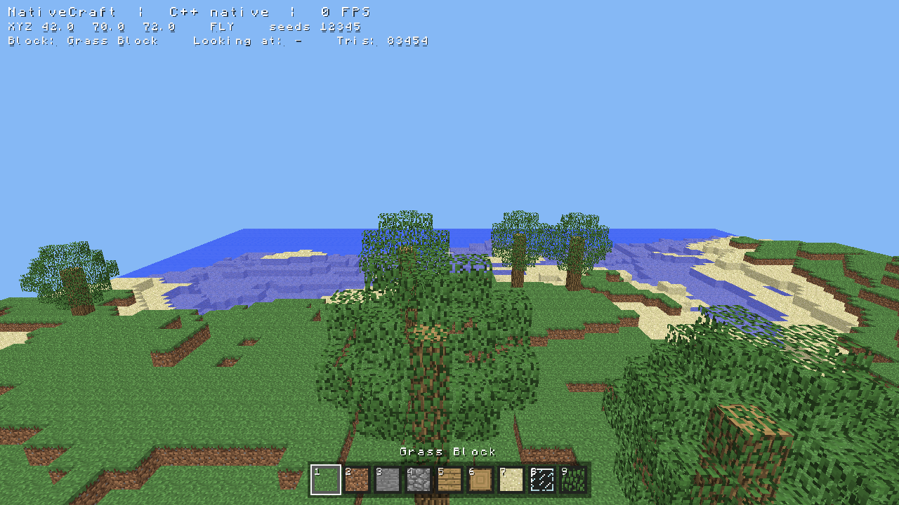
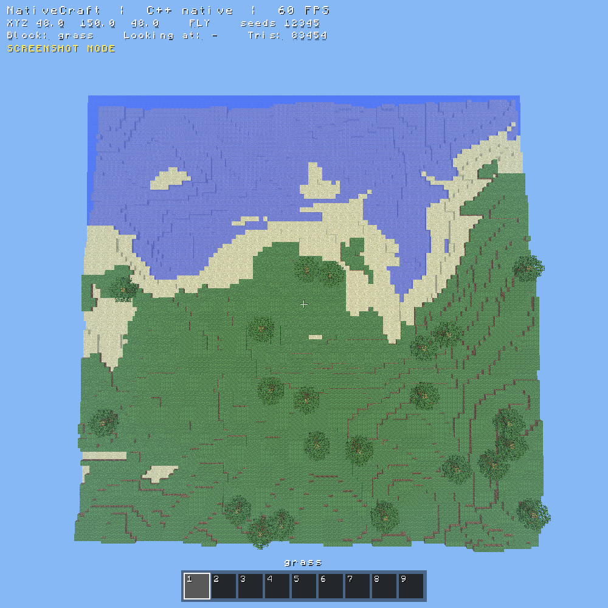
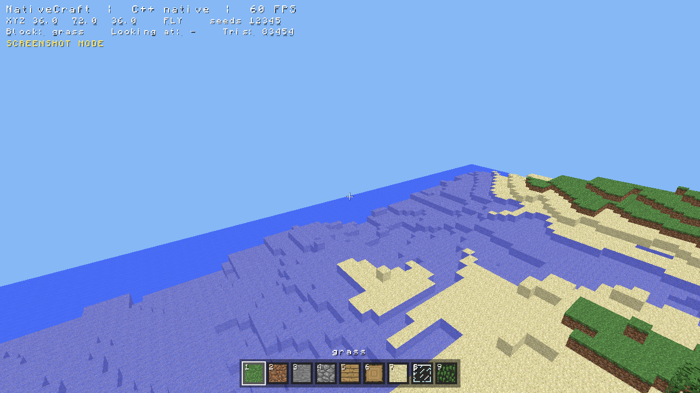
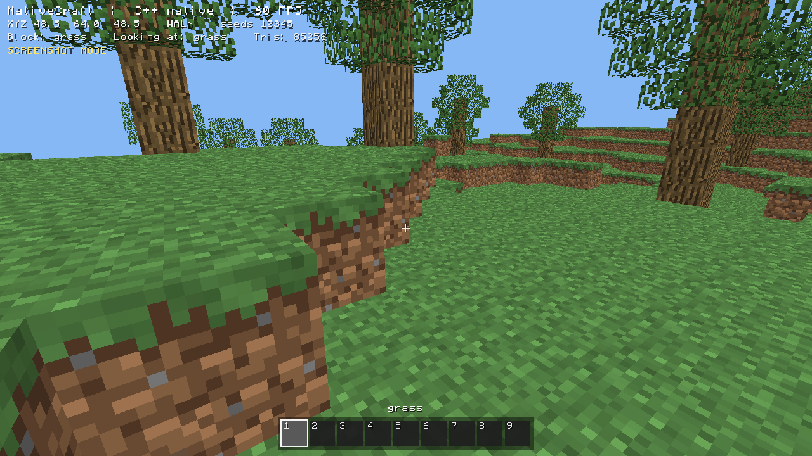

# NativeCraft

A native C++20 reimplementation of a Minecraft-style client. It does not use Java or the JVM. The renderer, world, player, asset pipeline, and sound system are written from scratch.

Textures, block models, blockstates, the bitmap font, language files, and sounds are read from a local Minecraft 1.12.2 installation. The repository does not contain Minecraft assets.

## Screenshots










## Requirements

- C++20 compiler (GCC 16 tested)
- CMake 3.20 or newer
- SDL2
- OpenGL 3.3
- libpng
- zlib
- OpenAL
- libvorbis and libvorbisfile

Installation instructions for Arch, Debian/Ubuntu, and Fedora are in [docs/INSTALL.md](docs/INSTALL.md).

## Build

```bash
cmake -S . -B build -DCMAKE_BUILD_TYPE=Release
cmake --build build -j
```

## Run

```bash
./build/nativecraft --mc-dir "$HOME/.minecraft"
```

The `--mc-dir` path must contain:

```text
versions/1.12.2/1.12.2.jar
assets/indexes/1.12.json
assets/objects/
```

## Controls

| Input | Action |
|---|---|
| Mouse | Look |
| W/A/S/D | Move |
| Space | Jump or fly up |
| Ctrl | Fly down |
| Shift | Sprint |
| F | Toggle flight |
| M | Toggle mouse capture |
| 1-9, mouse wheel | Select hotbar slot |
| Left click | Break block |
| Right click | Place block |
| F2 | Save screenshot to `screenshots/` |
| Esc | Exit |

## Offline rendering check

```bash
./build/nativecraft --mc-dir "$HOME/.minecraft" \
  --screenshot shots/check.png --frames 90 --width 1280 --height 720
```

Camera override:

```bash
./build/nativecraft --mc-dir "$HOME/.minecraft" \
  --camera 48 150 48 0 -89 --screenshot shots/top.png --frames 30
```

## Implemented

- Window and OpenGL 3.3 core renderer.
- ZIP/JAR reader, JSON parser, PNG loader, OpenAL/Vorbis audio.
- Blockstates, block models, and textures loaded from the 1.12.2 jar.
- 78 blocks, 101 unique block textures, 103 texture-array layers.
- 96x96x128 world with hills, beaches, water, ores, and trees.
- Walking, jumping, flight, AABB collision, and mouse look.
- Block breaking and placement with chunk remeshing.
- HUD with crosshair, hotbar icons, block names from `en_us.lang`, FPS, and coordinates.
- Footstep and block sounds selected by block material.
- Automatic screenshot mode.

## Limitations

- No save loading or saving. Anvil/NBT is not implemented.
- No inventory, item entities, crafting, mobs, lighting, or networking.
- Only cube-based block models are supported. Slabs, stairs, fences, panes, chests, and arbitrary JSON geometry are not implemented.
- Animated textures use the first frame.
- Audio is non-positional and limited to footsteps and block sounds.
- The world is a fixed 96x96 area with no chunk streaming or frustum culling.

## Documentation

- [Installation](docs/INSTALL.md)
- [Development notes](docs/DEVELOPMENT.md)

## Legal

This project does not include or redistribute Minecraft code or assets. It requires a legally obtained local Minecraft installation and only reads files from that installation. Minecraft is a trademark of Mojang Studios.
