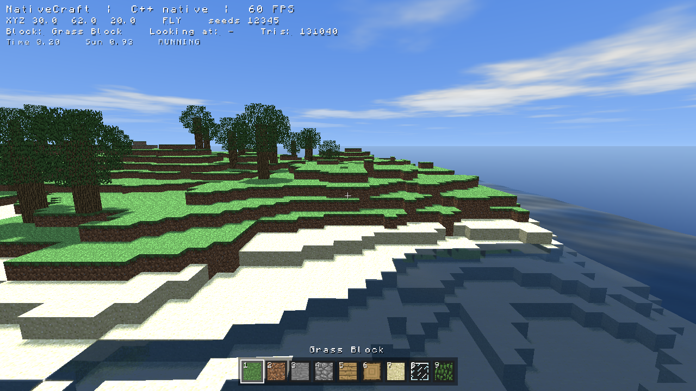
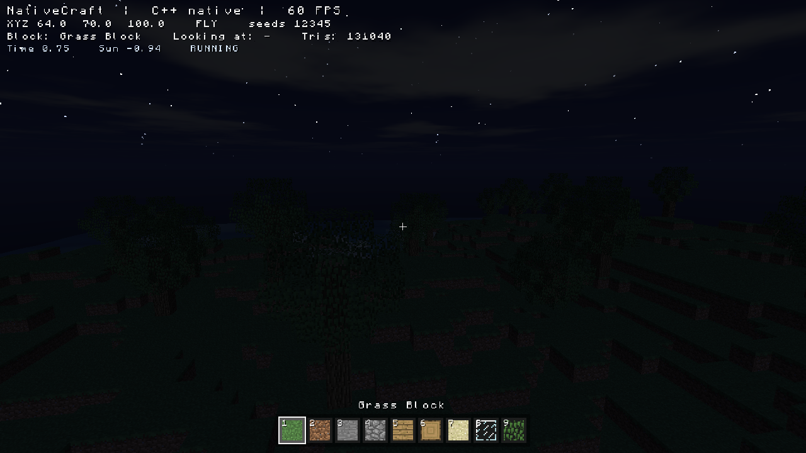

# NativeCraft

A native C++20 Minecraft-style client. It does not use Java or the JVM. The renderer, world, player, asset pipeline, and audio system are implemented from scratch.

Textures, block models, blockstates, the bitmap font, language files, and sounds are read from a local Minecraft 1.12.2 installation. The repository does not contain Minecraft assets.

## Screenshots








## Requirements

- C++20 compiler (GCC 16 tested)
- CMake 3.20 or newer
- SDL2
- OpenGL 3.3
- libpng
- zlib
- OpenAL
- libvorbis and libvorbisfile

Installation instructions for Arch, Debian/Ubuntu, and Fedora are in [docs/INSTALL.md](docs/INSTALL.md).

## Build

```bash
cmake -S . -B build -DCMAKE_BUILD_TYPE=Release
cmake --build build -j
```

## Run

```bash
./build/nativecraft --mc-dir "$HOME/.minecraft"
```

The directory must contain:

```text
versions/1.12.2/1.12.2.jar
assets/indexes/1.12.json
assets/objects/
```

## Controls

| Input | Action |
|---|---|
| Mouse | Look |
| W/A/S/D | Move |
| Space | Jump or fly up |
| Ctrl | Fly down |
| Shift | Sprint |
| F | Toggle flight |
| M | Toggle mouse capture |
| T | Pause or resume the day cycle |
| 1-9, mouse wheel | Select hotbar slot |
| Left click | Break block |
| Right click | Place block |
| F2 | Save screenshot to `screenshots/` |
| Esc | Exit |

## Rendering features

- Dynamic sun position and day/night cycle.
- Directional shadow mapping with 3x3 PCF filtering.
- Procedural moving clouds with parallax on a cloud plane.
- Stars and moon at night.
- Planar water reflections rendered from a mirrored camera.
- Animated water waves, ripples, Fresnel reflections, sun path, and specular highlights.
- Sky, fog, ambient light, and sun color driven by the time of day.
- Texture array for block textures, transparent pass for glass and ice.

## Offline rendering check

```bash
./build/nativecraft --mc-dir "$HOME/.minecraft" \
  --screenshot shots/check.png --frames 90 --width 1280 --height 720
```

Camera and time override:

```bash
./build/nativecraft --mc-dir "$HOME/.minecraft" \
  --time 0.20 --camera 64 70 100 10 -10 \
  --screenshot shots/scene.png --frames 60
```

## Implemented

- 8x8 chunk world (128x128x128) with an ocean margin.
- 64 chunks and about 131,000 triangles.
- 78 blocks, 101 unique block textures, 103 texture-array layers.
- Walking, jumping, flight, AABB collision, and mouse look.
- Block breaking and placement with chunk remeshing.
- HUD with crosshair, hotbar icons, block names from `en_us.lang`, FPS, coordinates, and time.
- Footstep and block sounds selected by block material.
- Automatic screenshot mode.

## Limitations

- No save loading or saving. Anvil/NBT is not implemented.
- No inventory, item entities, crafting, mobs, or networking.
- Only cube-based block models are supported.
- Animated textures use the first frame.
- No weather, volumetric lighting, or cloud shadows.
- Audio is non-positional and limited to footsteps and block sounds.
- The world is finite and has no chunk streaming or frustum culling.

## Documentation

- [Installation](docs/INSTALL.md)
- [Development notes](docs/DEVELOPMENT.md)

## Legal

This project does not include or redistribute Minecraft code or assets. It requires a legally obtained local Minecraft installation and only reads files from that installation. Minecraft is a trademark of Mojang Studios.
